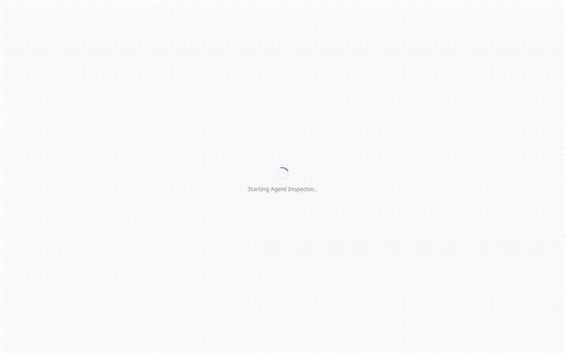

# Agent Inspector

A dev tool for manually driving [`llm-agents-from-scratch`](https://github.com/nerdai/llm-agents-from-scratch)'s
`LLMAgent.SupervisedTaskHandler` one call at a time, over HTTP, via a React
frontend.

This repo is a two-language monorepo (Python backend + TypeScript
frontend) packaged as a single PyPI wheel that bundles the built frontend
assets and ships a CLI.



## Installation

```bash
pip install llm-agents-from-scratch-inspector
```

This installs the `agent-inspector` CLI and pulls in
`llm-agents-from-scratch` as a dependency. (The PyPI distribution name
differs from the CLI command and the importable package,
`agent_inspector`, only because the short name was already taken on
PyPI.) If you're working from a clone of this repo instead, use
`uv sync` — see [Development](#development) below.

## Using your own agent

`agent-inspector launch` doesn't build an agent from flags or a config
file — it imports a Python script you write and looks for a
module-level `agent_builder`: an `LLMAgentBuilder`
(`llm_agents_from_scratch`) with at least `.with_llm(...)` called on
it, following the same fluent `with_*` pattern (`.with_tool(...)`,
`.with_skill(...)`, `.with_memory(...)`, ...) you'd use anywhere else
in the framework.

```python
# main.py
from llm_agents_from_scratch import LLMAgentBuilder
from llm_agents_from_scratch.data_structures import Task
from llm_agents_from_scratch.notebook_utils import make_llm

agent_builder = LLMAgentBuilder().with_llm(make_llm()).with_tool(my_tool)

# Optional -- pre-fills the UI's task field at launch time.
default_task = Task(instruction="Describe the task to run by default.")
```

```bash
export OLLAMA_API_KEY=<your key>
agent-inspector launch main.py
```

`make_llm()` is the library's own provider helper (see the
[Quickstart](#quickstart) for what it picks), but any `LLM` works
here -- e.g. `OllamaLLM(...)`, `OpenAILLM(...)`, or your own.

This opens a browser tab at the Inspector UI, where you can enter a
task and step through `get_next_step()`/`run_step()` against your own
agent instead of the bundled demo below. `demo.py` (used in the
Quickstart) is itself just an `agent_builder` script following this
same convention — see `docs/overview.md`'s "Entrypoint discovery"
section ([ADR-002](docs/adr/ADR-002-convention-based-entrypoint-discovery.md))
for the full mechanism.

If `launch` fails, the error is meant to tell you exactly what's
wrong rather than a bare traceback:

| Error                          | Likely cause                                                        |
|---------------------------------|-----------------------------------------------------------------------|
| script not found                | the path doesn't exist relative to your current directory             |
| error importing script          | the script itself raises — run `python main.py` directly to see why   |
| no `agent_builder` found        | the variable isn't named exactly `agent_builder`, or isn't at module scope |
| `agent_builder` has the wrong type | it isn't an `LLMAgentBuilder` instance                              |
| `agent_builder` isn't ready     | `.with_llm(...)` was never called on it before `launch` imports it    |
| `default_task` has the wrong type | it's present but isn't a `Task` instance                            |

Run `agent-inspector launch --help` for the full flag list (`--port`,
`--no-open`, `--session-ttl-seconds`, ...) — `--dev` and
`--backend-only` are for contributors working on this repo's own
frontend, not needed for a normal run.

## Quickstart

`demo.py` (repo root) is a ready-to-run `agent_builder` entrypoint --
a port of [`llm-agents-from-scratch`](https://github.com/nerdai/llm-agents-from-scratch)'s
`examples/ch08.ipynb` Example 3 (Hailstone sequence via a single
`next_number` tool), driven one call at a time through the Inspector's
UI instead of the notebook's own manual loop.

1. Create an [Ollama Cloud](https://ollama.com/cloud) API key at
   <https://ollama.com/settings/keys>.

2. From this repo's root:

   ```bash
   export OLLAMA_API_KEY=<your key>
   uv sync
   uv run agent-inspector launch demo.py
   ```

   This opens a browser tab with the task field pre-filled ("Compute
   the full Hailstone sequence starting from 4, ..."). Create the
   session and step through `get_next_step()`/`run_step()` until the
   agent reaches a final result to approve. The app bar shows an
   "ollama cloud" chip.

`demo.py` builds its LLM with `make_llm()` from
`llm_agents_from_scratch.notebook_utils`, the same helper the
library's chapter notebooks use, so it picks the library's current
default Ollama Cloud model rather than hard-coding one here.

**No API key?** The same command falls back to a local
[Ollama](https://ollama.com/download) with `qwen3:14b` -- run
`ollama pull qwen3:14b` once first. `make_llm()` starts the Ollama
service itself if it isn't already running, so there's no separate
`ollama serve` step; the app bar then shows the local daemon's
online/offline check instead. `OLLAMA_MODEL=<name>` overrides the
model on either path, and `LLM_PROVIDER=openai` or `anthropic`
switches provider (those need `llm-agents-from-scratch`'s `openai` /
`anthropic` extras).

## Development

`agent-inspector launch` takes a path to a Python script that exposes an
`agent_builder` (an `LLMAgentBuilder` instance) at module scope -- see
`docs/overview.md`'s "Entrypoint discovery" section for the full
convention:

```bash
uv sync
uv run agent-inspector launch main.py --dev
```

See `frontend/` for the React/Vite UI and `src/agent_inspector/` for the
FastAPI backend and CLI.

### Testing

```bash
make test-backend    # pytest, backend only
make test-frontend   # Playwright E2E, frontend + a real backend
make test            # both
```

`test-frontend` runs the checked-in suite under `frontend/e2e/` --
first time, install the browser binaries Playwright needs:

```bash
cd frontend && npx playwright install --with-deps chromium
```

The suite drives a real `agent-inspector launch` instance end to end
(no mocking), but needs no live Ollama daemon: `frontend/e2e/fixtures/
scripted_agent.py` is a network-free `agent_builder` backed by a
scripted `BaseLLM`, started automatically by `playwright.config.ts`'s
`webServer`. Nothing needs to be running beforehand.
